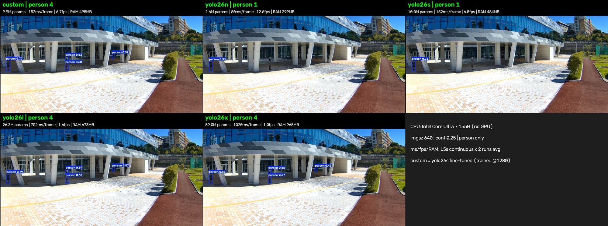
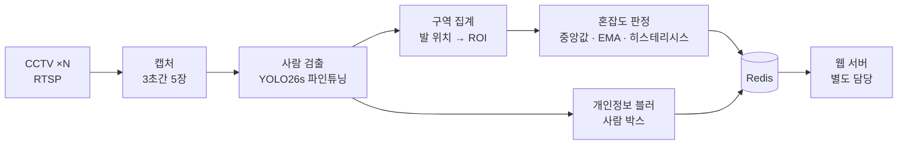
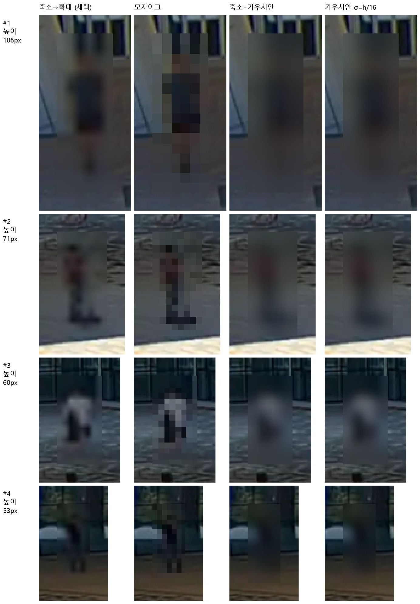

# YwHob: CCTV 기반 박람회 혼잡도 분석 시스템

YwHob은 2026 AI 미래교육 박람회 홈페이지에서 실시간 혼잡도 정보를 제공한 CCTV 분석 시스템입니다.

본 시스템은 현장 CCTV 영상에서 사람을 검출하여 구역별 혼잡도를 계산합니다. 계산한 혼잡도 수치와, 사람을 블러 처리한 현장 이미지를 박람회 홈페이지에 제공하였습니다.

**담당 범위**: 영상 수신 → 캡처 → 인원 추정 → 혼잡도 산출 → 블러 처리 → 웹 서버 전달

## 운영 결과

| 항목 | 내용 |
|---|---|
| 운영 기간 | 2026-10-31 ~ 2026-11-01 (실제 서비스 운영) |
| 서비스 대상 | 박람회 방문객, 부스 운영진, 행사 관리진 등 3,000+명 |
| 갱신 주기 | CCTV 1대당 10초마다 갱신 (주기마다 프레임 5장 캡처) |
| 실행 환경 | 노트북 1대에서 여러 대의 CCTV를 처리 |
| CCTV 영상 해상도 | 가로 640픽셀 |
| 안정성 | 운영 기간 동안 서비스 중단 없이 제공 |
| 개인정보 보호 | 원본 영상은 저장하거나 전송하지 않으며, 블러 처리한 이미지만 외부에 제공 |

## 검출 모델

본 시스템은 원거리의 작은 사람을 검출하도록 파인튜닝한 모델 **YolPe**를 사용합니다.

| 항목 | 내용 |
|---|---|
| 기반 모델 | Ultralytics YOLO26 Small (YOLO26s) |
| 학습 데이터 | CrowdHuman (군중 이미지 데이터셋) |
| 검출 대상 | 사람 1개 클래스 (`0: person`) |
| 모델 가중치 | [Hugging Face: illimax/YolPe](https://huggingface.co/illimax/YolPe) |
| 학습 및 평가 코드 | [GitHub: lkw-k/YolPe](https://github.com/lkw-k/YolPe) |
| 원거리 인식률 (박스 높이 48px 미만) | 기본 YOLO26s 0.225 → YolPe 0.798 (**약 3.5배 향상**) |
| 최소 인식 크기 (인식률 0.7 이상) | 기본 YOLO26s 128px → YolPe 24px (**약 5.3배 더 작은 사람까지 인식**) |
| 현장 영상 검출 인원 (같은 크기 모델) | 기본 YOLO26s 1명 → YolPe 4명 (**4배**) |

CCTV는 높은 위치에서 넓은 범위를 촬영합니다. 따라서 멀리 있는 사람은 화면에서 수십 픽셀 크기로 작게 보입니다. COCO 데이터셋으로 학습된 기본 모델은 이러한 작은 사람을 많이 놓치며, 그 결과 인원이 실제보다 적게 계산됩니다. 이 문제를 해결하기 위해 CrowdHuman 데이터셋으로 모델을 파인튜닝하여 원거리 인식률을 높였습니다. 상세한 평가 결과는 Hugging Face 모델 카드에 정리되어 있습니다.

### 모델 개발 과정

1. **기준선 측정**: COCO 사전학습 가중치(YOLO26s)로 사람 박스 높이 구간별 인식률을 먼저 측정하였습니다. 그 결과 인식률 0.7 이상을 얻는 최소 크기는 128px였습니다.
2. **데이터 선정**: 군중 장면이 많은 CrowdHuman 데이터셋을 선정하였습니다. 현장 샘플을 직접 라벨링하는 방안도 함께 검토하였습니다.
3. **파인튜닝**: CrowdHuman으로 사람 1개 클래스를 학습하였습니다 (입력 크기 1280, 최대 50 에폭).
4. **거리별 재평가**: 기준선과 같은 조건으로 다시 평가하여 원거리 인식률이 개선되었음을 확인하였습니다 (아래 표 참고).
5. **최적화**: 프레임 5장을 한 번에 추론하는 배치 추론을 적용하였습니다. ONNX 변환과 양자화도 최적화 방법으로 검토하였습니다.

### 검출 방식 결정 배경

처음에는 사람의 머리만 검출하는 방식을 계획하였습니다. 그러나 원거리에서는 머리가 잘 검출되지 않았고, 공과 같은 둥근 물체를 머리로 잘못 검출할 수 있었습니다. 사람 박스 안에서 머리를 추가로 확인하는 방식도 검토하였지만, 이 방식은 원거리 검출 한계가 머리 검출 한계에 묶이는 문제가 있었습니다. 따라서 `person` 1개 클래스로 원거리의 사람을 검출하는 방식을 채택하였습니다. 머리 확인 방식은 오검출이 실제로 문제가 될 경우에 다시 검토하기로 하고 보류하였습니다.

### 성능 비교: 기본 YOLO26s vs YolPe

CrowdHuman 검증 데이터(입력 크기 1280, conf 0.35)에서 몸의 75% 이상이 보이는 사람 48,204명을 기준으로 측정한 인식률(recall)입니다. 거리는 화면 속 사람 박스의 높이로 구분하였으며, 박스가 작을수록 멀리 있는 사람입니다.

| 거리 | 박스 높이 | 사람 수 | 기본 YOLO26s | YolPe | 향상 | 배수 |
|---|---|---|---|---|---|---|
| 원거리 | 48px 미만 | 5,535 | 0.225 | **0.798** | +0.573 | **3.5배** |
| 중거리 | 48~128px | 14,966 | 0.559 | **0.930** | +0.371 | **1.7배** |
| 근거리 | 128px 이상 | 27,703 | 0.852 | **0.969** | +0.117 | **1.1배** |
| 전체 | | 48,204 | 0.689 | **0.938** | +0.249 | **1.4배** |
| 최소 인식 크기 (인식률 0.7 이상) | | | 128px | **24px** | | **5.3배 작은 사람까지** |

> **핵심 성과**: 기본 모델이 가장 많이 놓치던 원거리 사람의 인식률이 **약 3.5배**(22.5% → 79.8%) 높아졌습니다. 인식할 수 있는 최소 사람 크기는 128px에서 24px로 **약 5.3배** 작아졌습니다.

### 성능 비교: YOLO26 모델 크기별 현장 영상 비교

실제 현장 CCTV 영상 한 장면에서 YolPe(custom)와 YOLO26 n / s / l / x 모델의 검출 결과 및 처리 속도를 비교하였습니다.



| 모델 | 파라미터 수 | 검출 인원 | 처리 시간 (프레임당) | 처리 속도 | 메모리 사용량 |
|---|---|---|---|---|---|
| **YolPe (custom)** | 9.9M | **4명** | 152ms | 6.7fps | 495MB |
| YOLO26n | 2.6M | 1명 | 80ms | 12.6fps | 399MB |
| YOLO26s | 10.0M | 1명 | 152ms | 6.8fps | 484MB |
| YOLO26l | 26.3M | 4명 | 702ms | 1.6fps | 673MB |
| YOLO26x | 59.0M | 4명 | 1020ms | 1.0fps | 968MB |

측정 조건: CPU Intel Core Ultra 7 155H (GPU 없음), 입력 크기 640, conf 0.25, person 클래스만 사용, 15초 연속 처리를 2회 반복한 평균값입니다. YolPe는 YOLO26s를 입력 크기 1280으로 파인튜닝한 모델입니다.

| YolPe와 비교 대상 | 검출 인원 | 처리 시간 | 파라미터 수 | 메모리 사용량 |
|---|---|---|---|---|
| vs YOLO26s (같은 크기) | **4배 많음** (1명 → 4명) | 같음 (152ms) | 같은 수준 | 같은 수준 |
| vs YOLO26l | 같음 (4명) | **약 4.6배 빠름** (702ms → 152ms) | **약 2.7배 작음** | **약 1.4배 적음** |
| vs YOLO26x | 같음 (4명) | **약 6.7배 빠름** (1020ms → 152ms) | **약 6.0배 작음** | **약 2.0배 적음** |

> **핵심 성과**: YolPe는 같은 크기의 기본 YOLO26s보다 **4배 많은 사람**을 같은 속도로 검출하였습니다. 또한 가장 큰 모델인 YOLO26x와 같은 수의 사람을 **약 6.7배 빠른 속도**, **약 6.0배 적은 파라미터**로 검출하였습니다. 이 결과는 GPU 없이 CPU만 사용한 환경에서 측정한 값입니다.

Small 모델과 Nano 모델의 정확도 및 추론 속도 비교는 아래 [모델 선택](#모델-선택-small--nano) 항목에 있습니다.

## 처리 흐름



```
캡처 (10초마다 5장) → 사람 검출 → 중앙값 집계 → EMA 스무딩 → 3단계 판정 → 블러 처리 → 전송
```

| 단계 | 설계 |
|---|---|
| 캡처 | 원본 프레임은 메모리에만 보관합니다. 카메라마다 캡처 시점을 분산하여 순간 부하를 줄입니다. |
| 검출 | 검출된 사람 박스 1개를 1명으로 계산합니다. |
| 집계 | 프레임 5장의 인원 중 중앙값을 사용합니다. 일시적인 가림과 오검출의 영향을 줄이기 위함입니다. |
| 신뢰도 | 프레임 5장 사이의 인원 편차로 신뢰도를 계산합니다. 편차가 크면 해당 주기의 결과를 버리고 직전 값을 유지합니다. |
| 스무딩 | 최근 3~5주기의 결과를 지수이동평균(EMA)으로 반영합니다. |
| 판정 | 상승 임계값과 하강 임계값을 분리(히스테리시스)하여, 경계 부근에서 단계가 반복적으로 바뀌는 현상을 막습니다. |

주기마다 프레임 5장을 캡처하는 목적은 사람의 이동 추적이 아니라 측정 노이즈 제거입니다.

### 처리량 설계

노트북 1대로 여러 대의 CCTV를 처리하기 위해, 실시간 스트림 처리 대신 주기별 배치 처리 구조로 설계하였습니다. 10초 주기 중 캡처에 사용하는 시간은 3초이며, 나머지 시간에 추론, 블러 처리, 전송을 수행합니다.

```
필요 처리량 = 카메라 수 × 5장 / 10초
가용 시간   = 10초 - 캡처 3초 - 전송 및 여유 시간
```

- 카메라마다 캡처 시점을 분산(stagger)하여 순간 부하를 줄입니다.
- 프레임 5장을 한 배치로 추론합니다.
- 캡처, 추론, 블러 처리, 전송 단계는 서로 독립적으로(비동기로) 동작합니다.

입력 해상도에 따라 다음과 같은 trade-off가 있습니다.

```
해상도를 낮추면 → 처리 속도 향상, 원거리 사람을 놓쳐 인원이 적게 계산됨
해상도를 높이면 → 정확도 향상, 처리 가능한 카메라 수가 줄어듦
```

가장 큰 위험은 검출 실패가 "사람 없음"으로 집계되는 것입니다. 따라서 검출 가능한 최소 사람 크기(박스 높이)를 먼저 측정하고, 그 기준으로 집계에서 제외할 원거리 영역을 정하였습니다.

## 구역 설계

카메라 1대의 화면을 여러 개의 관심 영역(ROI)으로 나누어, 각 영역을 하나의 구역으로 다룹니다. 가까운 영역과 먼 영역은 원근 차이가 크기 때문에 별도의 구역으로 나눕니다. 검출 신뢰도가 낮은 먼 영역은 집계에서 제외합니다. 각 ROI는 부스 배치를 기준으로 한 물리적 구역과 연결됩니다. 카메라마다 설치 높이, 각도, 촬영 면적이 다르므로 혼잡도 임계값은 카메라별로 조정하였습니다.

## 개인정보 보호

본 시스템의 이미지 처리 목적은 개인정보 보호입니다.

- 원본 프레임은 디스크, 로그, 네트워크 어디에도 남기지 않습니다. 블러 처리 후 메모리에서 즉시 삭제합니다.
- 블러 처리 후 박스마다 선명도를 검사합니다. **검사를 통과하지 못하면 이미지는 전송하지 않고 혼잡도 수치만 전송합니다.**

### 블러 처리 방식

| 항목 | 내용 |
|---|---|
| 방식 | 사람 박스 블러. 검출된 사람의 영역만 블러 처리하고 배경은 그대로 둡니다. 검출되지 않은 사람은 블러 처리되지 않지만, 이러한 사람은 원거리(박스 높이 24px 미만)에 있으므로 얼굴을 식별할 수 없다고 판단하였습니다. |
| 강도 | 사람 박스를 긴 변 16픽셀 크기로 축소한 뒤 다시 확대합니다. 이 과정에서 얼굴은 약 2픽셀 크기로 줄어들어 복원할 수 없게 됩니다. |
| 대상 | 프레임 5장 중 중앙값으로 채택된 1장만 블러 처리하여 전송합니다. |
| 검증 | 블러 처리 후 박스별 선명도(라플라시안 분산)를 측정하여 블러가 충분히 적용되었는지 확인합니다. |
| 보관 | 전송된 이미지의 서버 측 보관 기간은 웹 서버 담당 범위에서 정합니다. |

#### 블러 방식 비교

사람 박스 높이가 서로 다른 4개 사례(108px, 71px, 60px, 53px)에 4가지 블러 방식을 적용하여 비교하였습니다. 비교 결과에 따라 "축소→확대" 방식을 채택하였습니다.



| 방식 | 설명 |
|---|---|
| **축소→확대 (채택)** | 사람 박스를 긴 변 16픽셀로 축소한 뒤 원래 크기로 확대합니다. |
| 모자이크 | 사람 박스를 일정한 크기의 블록으로 나누어 단색으로 채웁니다. |
| 축소+가우시안 | 축소→확대 후 가우시안 블러를 추가로 적용합니다. |
| 가우시안 (σ = h/16) | 박스 높이(h)의 1/16을 표준편차로 하는 가우시안 블러를 적용합니다. |
- 본 저장소에는 카메라 위치, 접속 정보, 현장 영상이 포함되어 있지 않습니다. 카메라 설정 파일(`configs/cameras.yaml`)은 Git 관리 대상에서 제외하였습니다.

## 웹 서버 연동

분석 시스템은 구역별 최신 결과를 Redis에 덮어쓰고, 웹 서버는 Redis에서 이 값을 읽습니다. 이 구조를 통해 한쪽의 장애가 다른 쪽으로 전파되지 않습니다.

```json
{
  "zone_id": "zone_01",
  "level": 2,
  "score": 0.41,
  "confidence": "high",
  "image_url": "/snapshots/zone_01.jpg",
  "updated_at": "2026-10-31T10:00:00+09:00",
  "status": "ok"
}
```

| 필드 | 설명 |
|---|---|
| `level` | 혼잡도 3단계 (0: 여유, 1: 보통, 2: 혼잡) |
| `score` | 혼잡도 연속값. 그라데이션 표시와 임계값 조정에 사용합니다. |
| `confidence` | 프레임 5장 사이의 편차에 기반한 신뢰도 |
| `status` | 카메라 장애가 "여유"로 잘못 표시되지 않도록 상태를 함께 전달합니다. 30초(3주기) 동안 갱신되지 않으면 웹 서버가 `stale`로 판정합니다. |
| `image_url` | 이미지는 JSON에 포함하지 않고 URL만 전달합니다. |

갱신 주기가 10초이므로 웹 서버는 폴링 방식으로 값을 읽습니다.

## 실행 방법

저장소 루트 디렉터리에서 실행합니다. Python 3.11과 [uv](https://docs.astral.sh/uv/)가 필요합니다.

```bash
# 1. 설치 (추론용 모델 패키지 포함)
uv sync --extra model

# 2. 카메라 설정: 예시 파일을 복사한 뒤 CCTV RTSP 주소, 구역 ROI, capacity를 입력합니다
cp configs/cameras.example.yaml configs/cameras.yaml
uv run python scripts/roi_editor.py        # 현장 프레임 위에 ROI를 그려 YAML로 출력합니다

# 3. 모델 가중치를 models/ 디렉터리에 둡니다 (Git 관리 대상 아님, 아래 표 참고)

# 4. 설정을 검증한 뒤 실행합니다. Redis 주소는 configs/service.yaml의 redis.url입니다
uv run ywhob --check
uv run ywhob                # Small 모델 (기본값)
uv run ywhob --model n      # Nano 모델
```

### 모델 선택: Small / Nano

두 모델 모두 CrowdHuman 데이터셋으로 파인튜닝하였습니다 (입력 크기 1280, 50 에폭). `--model` 옵션을 지정하지 않으면 Small 모델을 사용합니다.

| 별칭 | 파일 | person mAP50 (CrowdHuman val) | 5장 추론 시간 (GPU / CPU) | 권장 상황 |
|---|---|---|---|---|
| `s` (기본값) | `models/yolo26s-ywhob-v1.pt` | 0.946 | 49ms / 660ms | GPU가 있는 노트북. 정확도 우선 |
| `n` | `models/yolo26n-ywhob-v1.pt` | 0.928 | 29ms / 230ms | GPU가 없거나, 카메라가 많아 10초 주기 안에 추론이 끝나지 않는 경우 |

추론 시간은 개발 PC(RTX 4070)에서 1920×1080 프레임 5장을 한 배치로, 입력 크기 1280으로 측정한 값입니다. 영상 디코딩 부하는 포함하지 않았습니다.

- 로그에 `주기 처리 N초 (주기 10초 초과)` 경고가 반복되면 Nano 모델로 변경합니다.
- 다른 가중치 파일은 경로로 지정할 수 있습니다: `uv run ywhob --model models/yolo26s-ywhob-v2.onnx`
- 모델 별칭과 파일 경로는 `configs/service.yaml`의 `detector.models`에서 변경합니다.

### CCTV 설정 참고 사항

- RTSP 스트림은 TCP로 수신합니다 (`capture.rtsp_transport`). 연결 또는 수신이 10초 이상 멈추면 자동으로 다시 연결합니다.
- 노트북의 영상 디코딩 부하를 줄이려면 CCTV의 서브스트림이나 낮은 프레임 레이트(예: 5fps)를 사용합니다. ROI 좌표는 실제로 수신하는 스트림의 해상도를 기준으로 지정합니다.
- `configs/cameras.yaml`에는 RTSP 계정 정보가 포함되므로 Git에 올리지 않습니다. 로그에도 URL 대신 카메라 ID만 기록합니다.
- 카메라 연결이 끊기면 해당 구역은 `status: error`로 전송되며, 다시 연결되면 다음 주기부터 정상 값이 전송됩니다.

## 한계

- 많이 가려진 사람은 검출하지 못할 수 있습니다. 따라서 밀집된 군중에서는 인원이 실제보다 적게 계산될 수 있습니다.
- 16픽셀보다 작은 사람은 대부분 검출하지 못합니다.
- 포스터 속 인물이나 마네킹처럼 사람과 비슷한 물체를 사람으로 검출할 수 있습니다.

## 라이선스

- 모델 가중치: AGPL-3.0 (Ultralytics YOLO26 라이선스를 따릅니다)
- 학습 데이터인 CrowdHuman은 비상업적 연구 목적으로만 사용할 수 있습니다.
